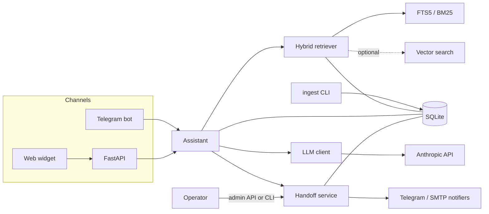

# ai-support-assistant

A customer-support assistant that answers questions from a business's own documentation and hands
the conversation to a person when it cannot. Answers are generated by Claude, cite the documents
they rely on, and are refused rather than guessed when the documents are silent.

It ships with a Telegram bot, an HTTP API and an embeddable web chat widget. Everything is stored
in a single SQLite file, and the only external service it needs is the Anthropic API.

The bundled sample knowledge base describes a fictional bike repair shop. All of its names,
prices and policies are invented.

## Features

- **Ingestion**: Markdown, plain text, PDF (with page numbers), HTML, single URLs and sitemaps,
  split into overlapping chunks with source, title and page metadata.
- **Hybrid retrieval**: BM25 over SQLite FTS5 by default; an optional embeddings backend behind an
  interface, fused with reciprocal rank fusion when enabled.
- **Grounded answers**: numbered citations, an explicit "not in the documentation" path, and a
  system prompt that forbids inventing prices or policies. Documents are treated as data, never as
  instructions.
- **Human handoff**: triggered by low retrieval confidence, an explicit request for a person, or
  repeated failures. Creates a ticket and notifies an operator by Telegram and/or email.
- **Channels**: Telegram bot and a FastAPI service with a streaming (SSE) widget.
- **Operations**: per-session memory, conversation logs, an analytics endpoint with a list of
  unanswered questions, rate limiting, input limits, structured JSON logs.

## Architecture



| Package                    | Responsibility                                                       |
| -------------------------- | -------------------------------------------------------------------- |
| `support_assistant.domain` | Plain value types shared by every layer                              |
| `.ingestion`               | Loaders, chunking and the ingest pipeline                            |
| `.storage`                 | SQLite schema and stores for knowledge, conversations, tickets       |
| `.retrieval`               | `Retriever` and `Embedder` protocols, FTS5, vector and hybrid search |
| `.llm`                     | `LLMClient` protocol, Anthropic client, prompts, offline fake        |
| `.service`                 | `Assistant`, handoff, rate limiting, input hygiene                   |
| `.notify`                  | Operator notifications and delivery of operator replies              |
| `.channels`                | Telegram bot, HTTP API and the web widget assets                     |
| `.factory`                 | Wires the object graph from `Settings`                               |

For each question the assistant retrieves the best chunks, and if none reaches `MIN_RELEVANCE` it
escalates without calling the model. Otherwise it sends the chunks and the recent conversation to
Claude. If the model replies that the documents do not contain the answer, the customer is told so;
after `HANDOFF_AFTER_FAILURES` consecutive failures in a session the conversation is escalated.

## Quickstart

Requires Python 3.12 and [uv](https://docs.astral.sh/uv/).

```sh
uv sync
cp .env.example .env              # set ANTHROPIC_API_KEY
uv run support-assistant ingest knowledge_base
uv run support-assistant serve    # http://127.0.0.1:8000
```

Open `http://127.0.0.1:8000/` for a demo page with the widget. To try the project without an API
key, set `LLM_PROVIDER=fake`: answers are then extracted from the retrieved documents with no
network access.

From the terminal:

```sh
uv run support-assistant ask "How long does a standard service take?"
```

### Docker

```sh
cp .env.example .env
docker compose run --rm ingest        # load /app/knowledge_base into the data volume
docker compose up -d api              # http://localhost:8000
docker compose --profile telegram up -d telegram
```

Build with `--build-arg WITH_EMBEDDINGS=true` to include the optional embeddings extra. The image
runs as a non-root user and keeps its database in the `/data` volume.

## Usage

### Ingesting documents

```sh
support-assistant ingest ./docs                          # directory, recursive
support-assistant ingest handbook.pdf
support-assistant ingest --url https://example.com/faq
support-assistant ingest --sitemap https://example.com/sitemap.xml --limit 100
support-assistant ingest ./docs --reset                  # replace the whole knowledge base
```

Re-ingesting a file replaces its previous chunks, so the command is safe to repeat. Files that
cannot be parsed are reported and skipped. Local sources are named by their path relative to the
ingested directory; web pages by URL.

### Web widget

Add one tag to any page:

```html
<script src="https://support.example.com/widget.js" data-title="Help"></script>
```

Optional attributes: `data-api` (defaults to the script's origin), `data-greeting`, `data-accent`.
If the page is on a different origin, list it in `CORS_ORIGINS`. Responses stream over SSE. When a
conversation is handed off, the widget polls for operator replies.

### HTTP API

| Method and path                                | Purpose                                              |
| ---------------------------------------------- | ---------------------------------------------------- |
| `POST /api/chat`                               | Answer one message: `{"session_id", "message"}`      |
| `POST /api/chat/stream`                        | Same, as server-sent `token`, `done` and `error` events |
| `GET /api/sessions/{id}/operator-replies`      | Operator replies for a session (`?after=<id>`)       |
| `GET /health`                                  | Liveness and knowledge-base size                     |
| `GET /admin/tickets`, `GET /admin/tickets/{id}` | List and inspect tickets (`?status=open`)           |
| `POST /admin/tickets/{id}/reply`               | Reply to the customer: `{"message"}`                 |
| `POST /admin/tickets/{id}/close`               | Close a ticket                                       |
| `GET /admin/analytics?days=30`                 | Questions per day, handoff rate, unanswered questions |
| `GET /admin/sessions/{id}/messages`            | Conversation log                                     |

Admin endpoints require `Authorization: Bearer $ADMIN_TOKEN` and are disabled while `ADMIN_TOKEN`
is empty. Session ids are chosen by the client (8 to 64 characters of `A-Za-z0-9_-`) and act as
bearer secrets, so generate them randomly, as the widget does.

### Telegram

Create a bot with [@BotFather](https://t.me/BotFather), set `TELEGRAM_BOT_TOKEN`, then run
`support-assistant telegram`. The bot answers in private chats; `/human` requests a person. For
operator notifications set `TELEGRAM_OPERATOR_CHAT_ID` to the chat that should receive them.

### Handling tickets

```sh
support-assistant tickets list --status open
support-assistant tickets show 12
support-assistant tickets reply 12 "Your bike is ready for collection."
support-assistant tickets close 12
```

Replies to Telegram customers are sent immediately. Replies to web customers are stored and picked
up by the widget. Email notifications need `SMTP_HOST` and `OPERATOR_EMAIL`.

## Configuration

All settings are environment variables, optionally read from `.env`. See `.env.example`.

| Variable                                   | Default                     | Description                                              |
| ------------------------------------------ | --------------------------- | -------------------------------------------------------- |
| `BUSINESS_NAME`                            | `Spoke & Chain Cycle Works` | Name used in the system prompt and bot greeting          |
| `DATABASE_PATH`                            | `data/assistant.db`         | SQLite file                                              |
| `LLM_PROVIDER`                             | `anthropic`                 | `anthropic`, or `fake` for offline trials                |
| `ANTHROPIC_API_KEY`                        | unset                       | Required when `LLM_PROVIDER=anthropic`                   |
| `ANTHROPIC_MODEL`                          | `claude-sonnet-5-5`         | Model id                                                 |
| `MAX_OUTPUT_TOKENS`                        | `1024`                      | Cap on answer length                                     |
| `CHUNK_SIZE` / `CHUNK_OVERLAP`             | `900` / `150`               | Chunk length and overlap, in characters                  |
| `RETRIEVAL_TOP_K`                          | `5`                         | Chunks passed to the model                               |
| `MIN_RELEVANCE`                            | `0.4`                       | Minimum relevance (0-1) before escalating without answering |
| `EMBEDDINGS_BACKEND`                       | `none`                      | `none` or `fastembed`                                    |
| `EMBEDDING_MODEL`                          | `BAAI/bge-small-en-v1.5`    | fastembed model name                                     |
| `MEMORY_TURNS`                             | `6`                         | Past exchanges included in each request                  |
| `MAX_INPUT_CHARS`                          | `1000`                      | Longest accepted customer message                        |
| `RATE_LIMIT_REQUESTS` / `..._WINDOW_SECONDS` | `10` / `60`               | Per-session limit; the per-IP limit is three times this  |
| `HANDOFF_AFTER_FAILURES`                   | `2`                         | Consecutive failures before escalating                   |
| `TELEGRAM_BOT_TOKEN`                       | unset                       | Enables the Telegram bot and reply delivery              |
| `TELEGRAM_OPERATOR_CHAT_ID`                | unset                       | Chat that receives handoff notifications                 |
| `SMTP_HOST`, `SMTP_PORT`, `SMTP_USERNAME`, `SMTP_PASSWORD`, `SMTP_STARTTLS`, `SMTP_FROM` | unset, `587`, ..., `true` | Mail server for notifications |
| `OPERATOR_EMAIL`                           | unset                       | Recipient of handoff emails                              |
| `ADMIN_TOKEN`                              | unset                       | Bearer token for `/admin/*`; admin API is off when empty |
| `CORS_ORIGINS`                             | empty                       | Comma-separated origins allowed to call the API          |
| `HOST` / `PORT`                            | `127.0.0.1` / `8000`        | Bind address for `serve`                                 |
| `LOG_LEVEL` / `LOG_FORMAT`                 | `INFO` / `json`             | `json` or `console`                                      |

### Tuning relevance

Relevance for the default backend is the share of the question's content words found in a chunk
(after light stemming), not the raw BM25 score, because BM25 scores cannot be compared across
queries. Raise `MIN_RELEVANCE` if the assistant answers things it should escalate; lower it if
it escalates too eagerly. With embeddings enabled, relevance is the larger of the lexical share
and the cosine similarity, and cosine values run higher, so start around `0.6`.

### Embeddings

```sh
uv sync --extra embeddings
EMBEDDINGS_BACKEND=fastembed uv run support-assistant ingest knowledge_base
```

Vectors are stored in SQLite and searched exhaustively. Documents ingested before enabling the
backend must be ingested again to be embedded.

## Extending

- **Another channel**: build a class that receives text and a session id, calls
  `container.assistant.reply(...)` (or `.stream(...)`), and renders the `Reply`. Use a distinct
  session prefix such as `slack:<channel>`. `channels/telegram.py` is a compact example. Add a
  `ReplyDelivery` implementation in `notify/` if operators should be able to answer into it.
- **Another retriever or embedder**: implement `Retriever.search` or `Embedder.embed` (both are
  protocols in `retrieval/base.py`) and add the instance to the list in `factory.build_container`.
  `HybridRetriever` fuses any number of retrievers.
- **Another model provider**: implement `LLMClient` (`complete` and `stream`, both async) and
  return it from `factory.create_llm`.
- **Another notifier**: implement `Notifier.notify_handoff` and add it to `create_notifier`.

## Safety notes

- Retrieved text and customer messages are placed inside delimited blocks, markup that could close
  those blocks is escaped, and the system prompt instructs the model to treat both as data. This
  reduces prompt-injection risk; it does not eliminate it. Do not ingest documents you do not trust.
- The model is told never to invent prices or policies, but it can still make mistakes. Review the
  unanswered and handoff lists regularly and keep the documentation authoritative.
- Ingest from URLs fetches whatever the given address serves. Run it only with addresses you
  choose.

## Limitations

- Retrieval quality is that of keyword search plus, optionally, a small local embedding model.
  There is no reranker, and the stopword list and stemmer are English-only.
- The default relevance check is heuristic and needs tuning per knowledge base.
- Rate limits live in process memory, so they are per process and reset on restart. IP limiting uses the socket address; behind a reverse proxy, every
  client appears as the proxy unless the server is configured to trust forwarded headers.
- SQLite with one connection per operation suits a single node and moderate traffic. Vector search
  scans every embedding.
- Web customers see operator replies by polling every 15 seconds.
- No authentication for end users, no attachments, and PDFs must contain extractable text (there
  is no OCR).
- The Telegram bot uses long polling and handles private chats only.

## Development

```sh
uv sync
uv run ruff check . && uv run ruff format --check .
uv run mypy
uv run pytest
```

Tests run offline using `FakeLLM`. See [CONTRIBUTING.md](CONTRIBUTING.md) and
[CHANGELOG.md](CHANGELOG.md).

## License

MIT. See [LICENSE](LICENSE).
